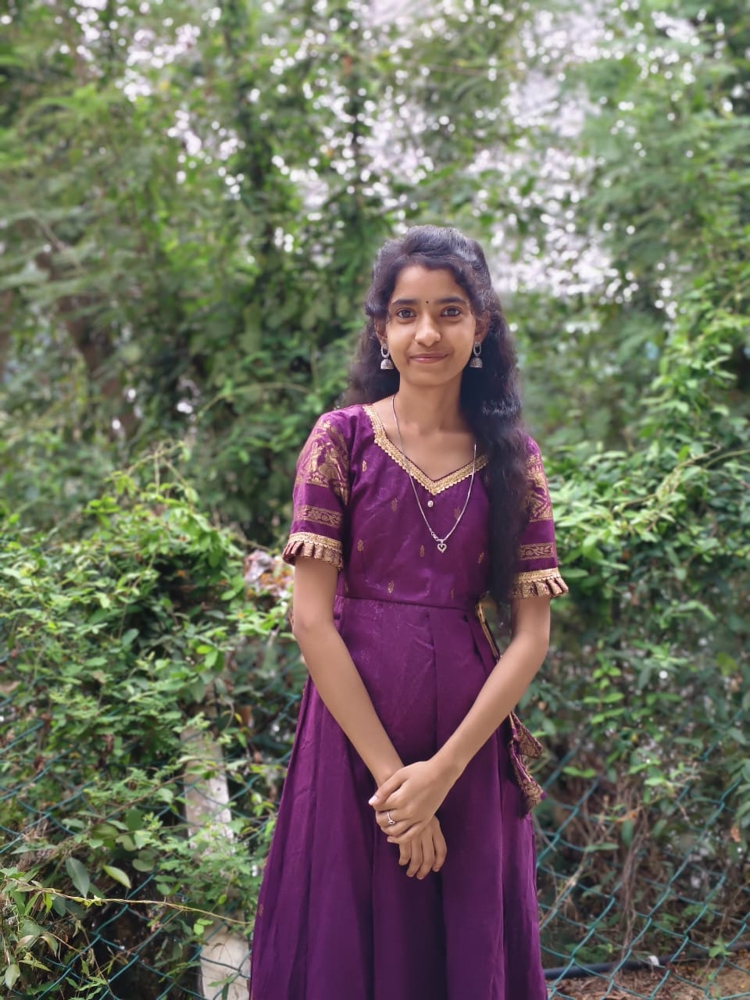
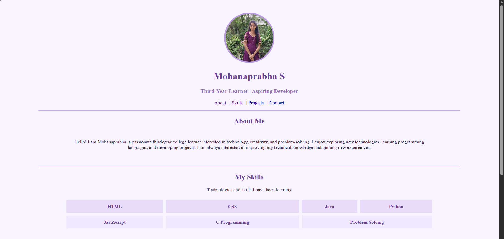
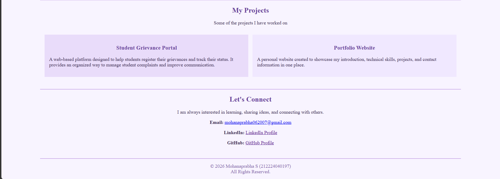

# Ex01 Portfolio
# Date: 30-10-2026
# AIM
To create a Portfolio using HTML and CSS.

# ALGORITHM
STEP 1
Create an HTML file (index.html)

STEP 2
Create a CSS file (style.css)

STEP 3
Include a navigation bar with links to different sections.

STEP 4
Add structured sections for introduction, about, projects, and contact details.

STEP 5
Define global styles for fonts, colors, and layout.

STEP 6
Style the header, navigation bar, and sections.

STEP 7
Use Flexbox or CSS Grid for layout design.

STEP 8
Add hover effects and transitions for interactivity.

STEP 9
Add Images and Media.

STEP 10
Use optimized images for a professional look.

STEP 11
Open the HTML file in a browser to check layout and functionality.

STEP 12
Fix styling issues and refine content placement.

STEP 13
Deploy the Portfolio.

STEP 14
Upload to GitHub Pages for free hosting.

# PROGRAM
## index.html
```


<!DOCTYPE html>
<html>
<head>
    <title>Mohanaprabha Portfolio</title>
</head>

<body bgcolor="#F8F4FF" text="#392B50">

    <!-- Header -->
    <center>
        <br><br>

        

        <h1><font color="#68429A">Mohanaprabha S</font></h1>

        <h3><font color="#9670BA">
            Third-Year Learner | Aspiring Developer
        </font></h3>

        <p>
            <a href="#about">About</a> &nbsp; |
            <a href="#skills">Skills</a> &nbsp; |
            <a href="#projects">Projects</a> &nbsp; |
            <a href="#contact">Contact</a>
        </p>

        <hr color="#C9A9E8" width="85%">
    </center>


    <!-- About Me -->
    <center>
        <h2 id="about">
            <font color="#68429A">About Me</font>
        </h2>
    </center>

    <table width="75%" align="center" cellpadding="10">
        <tr>
            <td align="center">
                <p>
                    Hello! I am Mohanaprabha, a passionate third-year
                    college learner interested in technology, creativity,
                    and problem-solving. I enjoy exploring new technologies,
                    learning programming languages, and developing projects.
                    I am always interested in improving my technical
                    knowledge and gaining new experiences.
                </p>
            </td>
        </tr>
    </table>

    <br>
    <hr color="#C9A9E8" width="85%">


    <!-- Skills -->
    <center>
        <h2 id="skills">
            <font color="#68429A">My Skills</font>
        </h2>
        <p>Technologies and skills I have been learning</p>
    </center>

    <table width="75%" align="center" cellpadding="12" cellspacing="10">
        <tr align="center">
            <td bgcolor="#E9DCFA">
                <font color="#68429A"><b>HTML</b></font>
            </td>

            <td bgcolor="#E9DCFA">
                <font color="#68429A"><b>CSS</b></font>
            </td>

            <td bgcolor="#E9DCFA">
                <font color="#68429A"><b>Java</b></font>
            </td>

            <td bgcolor="#E9DCFA">
                <font color="#68429A"><b>Python</b></font>
            </td>
        </tr>

        <tr align="center">
            <td bgcolor="#F0E8FF">
                <font color="#68429A"><b>JavaScript</b></font>
            </td>

            <td bgcolor="#F0E8FF">
                <font color="#68429A"><b>C Programming</b></font>
            </td>

            <td bgcolor="#F0E8FF" colspan="2">
                <font color="#68429A"><b>Problem Solving</b></font>
            </td>
        </tr>
    </table>

    <br>
    <hr color="#C9A9E8" width="85%">


    <!-- Projects -->
    <center>
        <h2 id="projects">
            <font color="#68429A">My Projects</font>
        </h2>

        <p>Some of the projects I have worked on</p>
    </center>

    <table width="85%" align="center" cellpadding="15" cellspacing="15">
        <tr>
            <td width="50%" bgcolor="#E9DCFA" valign="top">
                <center>
                    <h3><font color="#68429A">
                        Student Grievance Portal
                    </font></h3>
                </center>

                <p>
                    A web-based platform designed to help students
                    register their grievances and track their status.
                    It provides an organized way to manage student
                    complaints and improve communication.
                </p>
            </td>

            <td width="50%" bgcolor="#F0E8FF" valign="top">
                <center>
                    <h3><font color="#68429A">
                        Portfolio Website
                    </font></h3>
                </center>

                <p>
                    A personal website created to showcase my
                    introduction, technical skills, projects,
                    and contact information in one place.
                </p>
            </td>
        </tr>
    </table>

    <br>
    <hr color="#C9A9E8" width="85%">


    <!-- Contact -->
    <center>
        <h2 id="contact">
            <font color="#68429A">Let's Connect</font>
        </h2>

        <p>
            I am always interested in learning, sharing ideas,
            and connecting with others.
        </p>

        <p>
            <b>Email:</b>
            <a href="mailto:mohanaprabha062007@gmail.com">
                mohanaprabha062007@gmail.com
            </a>
        </p>

        <p>
            <b>LinkedIn:</b>
            <a href="https://www.linkedin.com/in/mohana-prabha-09b644353/" target="_blank">
                LinkedIn Profile
            </a>
        </p>

        <p>
            <b>GitHub:</b>
            <a href="https://github.com/MohanaprabhaS" target="_blank">
                GitHub Profile
            </a>
        </p>
    </center>

    <br>

    <!-- Footer -->
    <center>
        <hr color="#C9A9E8" width="85%">

        <p>
            <font color="#8060A8">
                &copy; 2026 Mohanaprabha S (212224040197)
                <br>
                All Rights Reserved.
            </font>
        </p>
    </center>

</body>
</html>

```
# OUTPUT




# RESULT
The program for creating Portfolio using HTML and CSS is executed successfully.